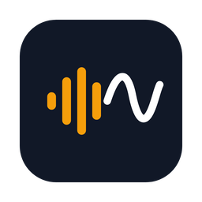

<p align="center">
  
</p>

<h1 align="center">說寫 WavePen</h1>

<p align="center">
  給 Mac 的 AI 語音輸入工具：按住快速鍵說話，放開後，整理好的繁體中文就打進你正在用的 App。<br/>
  體驗接近 Typeless，開源、自備 API Key，資料不經過任何第三方伺服器。
</p>

<p align="center">
  <a href="https://github.com/eddy0594/WavePen/releases/latest"><strong>下載</strong></a> ·
  <a href="docs/WavePen-安裝說明.md"><strong>安裝說明</strong></a> ·
  <a href="#english"><strong>English</strong></a>
</p>

---

## 特色

- **按住說話，放開就打字**：預設按住 `Fn` 聽寫，也可以改成右 Option。在 LINE、Gmail、Notion、Word、瀏覽器裡都能用。
- **AI 自動潤飾**：去掉「嗯、那個、就是說」等贅字，補上標點、整理條列，講錯改口也會自動採用改過的版本。
- **台灣繁體中文**：語音辨識和 AI 輸出一律轉成台灣用語的繁體字（例如「文件保存」→「檔案儲存」），中英夾雜照樣保留。
- **邊寫邊打**：AI 一邊產生一邊輸出，不用等整段寫完。
- **越用越準**：聽寫完馬上修正錯字（例如「論識」改成「潤飾」），會自動加進詞典，下次辨識就會對。
- **詞典提示**：常用的人名、產品名加進詞典，辨識時會優先採用。
- **Ask Anything**：`Fn + Space` 用語音問問題，答案顯示在小視窗。
- **選取文字改寫、翻譯**：選取一段文字後說「改得正式一點」或「翻成英文」。
- **在任何畫面都看得到錄音狀態**：錄音膠囊會出現在每個桌面和全螢幕 App 上。
- **介面**：繁體中文、English（另有簡體中文等 10 種語言）。

## 費用

WavePen 本身免費。語音辨識和 AI 潤飾使用你自己的 OpenAI API Key，按用量計費：

| 項目 | 模型 | 單價 |
| --- | --- | --- |
| 語音辨識 | `gpt-4o-transcribe` | US$0.006／分鐘 |
| AI 潤飾 | `gpt-4o-mini` | US$0.15／百萬輸入 token |

每個月說 8,000 字（約 50 分鐘錄音）大約 US$0.35（新台幣 10～15 元）。也支援 Groq、Deepgram、Gemini、Claude、OpenRouter、Ollama 等服務。

## 安裝

1. 從 [Releases](https://github.com/eddy0594/WavePen/releases/latest) 下載 `WavePen_x.y.z_universal.dmg`（Apple 晶片與 Intel 通用，macOS 12 以上）。
2. 拖進「應用程式」資料夾。
3. 第一次開啟時 macOS 會擋下（App 未經 Apple 公證），到「系統設定 → 隱私權與安全性」按「強制打開」。

完整步驟、權限設定和常見問題請看 [安裝說明](docs/WavePen-安裝說明.md)。

## 隱私

- API Key 存在 macOS 鑰匙圈。
- 錄音只送到你設定的語音辨識服務，不經過 WavePen 的伺服器（WavePen 沒有伺服器）。
- 判斷目前使用哪個 App 在本機完成；「修正後自動學習」只在記憶體比對剛打出去的那段文字，不儲存也不上傳。
- 沒有帳號、沒有追蹤。

## 從原始碼建置

需要 Node.js 20+、Rust stable、CMake，以及 [Tauri 的系統需求](https://v2.tauri.app/start/prerequisites/)。

```bash
npm ci
npm run tauri dev
```

打包成通用版 DMG：

```bash
./scripts/package-macos.sh
```

鑰匙圈裡有名為 `WavePen Self-Signed Code Signing` 的程式碼簽署憑證時，腳本會用它簽署，更新版本後 macOS 權限不必重新授予；沒有的話會改用臨時簽章。

測試：

```bash
npm test
cd src-tauri && cargo test
```

## 致謝

WavePen 修改自 [OpenTypeless](https://github.com/tover0314-w/opentypeless)（MIT 授權），感謝原作者與所有貢獻者。主要改動：

- 改為只自備 API Key，移除帳號、付費與官方雲端服務
- 新增台灣繁體中文介面與繁體輸出轉換
- 語音辨識改用 `gpt-4o-transcribe`、詞典提示、靜音與幻覺過濾
- AI 邊寫邊打、修正後自動學習詞典
- macOS 右 Option 快速鍵、全螢幕 App 上的錄音膠囊、Dock 圖示開關
- 新名稱與圖示

第三方元件授權請見 [THIRD_PARTY_NOTICES.md](THIRD_PARTY_NOTICES.md)。

## 授權

[MIT](LICENSE)

---

<a id="english"></a>

## English

**WavePen (說寫)** is an open-source, Typeless-style AI dictation app for macOS, focused on Traditional Chinese (Taiwan) and English. Hold a hotkey, speak, release — clean, punctuated text is typed into whatever app you are using.

- Hold `Fn` (or Right Option) to dictate; AI removes filler words, adds punctuation, and applies your spoken self-corrections.
- Chinese output is converted to Traditional Chinese with Taiwan vocabulary via OpenCC; mixed Chinese/English is preserved.
- Polished text streams into the target app as it is generated.
- Fix a misrecognized word right after dictation and WavePen learns it as a dictionary correction.
- Bring your own OpenAI key (or Groq, Deepgram, Gemini, Claude, OpenRouter, Ollama). About US$0.35/month for ~50 minutes of speech.
- No account, no telemetry, no WavePen servers. API keys live in the macOS Keychain.

Download the universal DMG from [Releases](https://github.com/eddy0594/WavePen/releases/latest). The app is not notarized, so allow it once in System Settings → Privacy & Security.

Build from source with `npm ci && npm run tauri dev`, or package with `./scripts/package-macos.sh`.

WavePen is a fork of [OpenTypeless](https://github.com/tover0314-w/opentypeless), released under the [MIT License](LICENSE).
